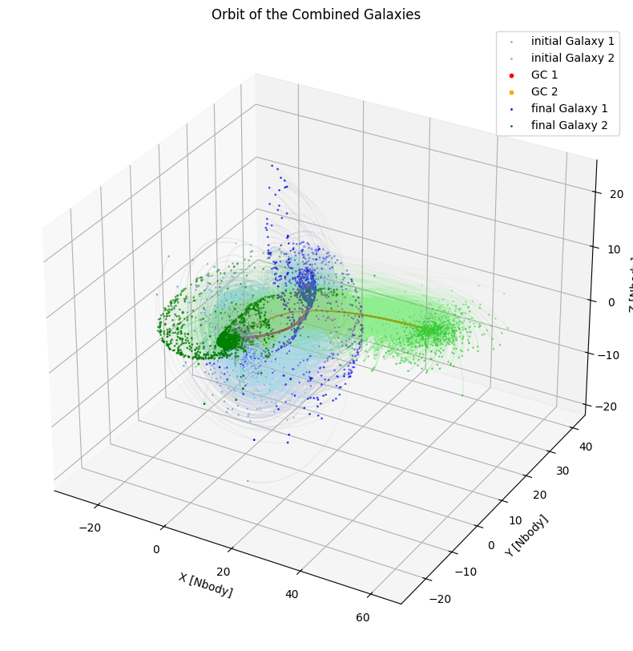
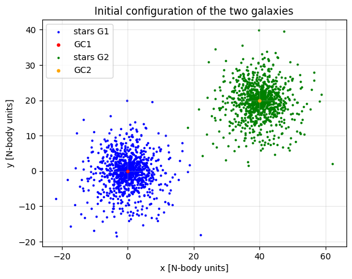
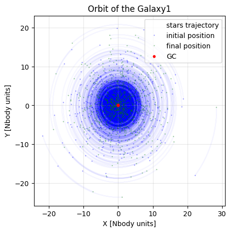
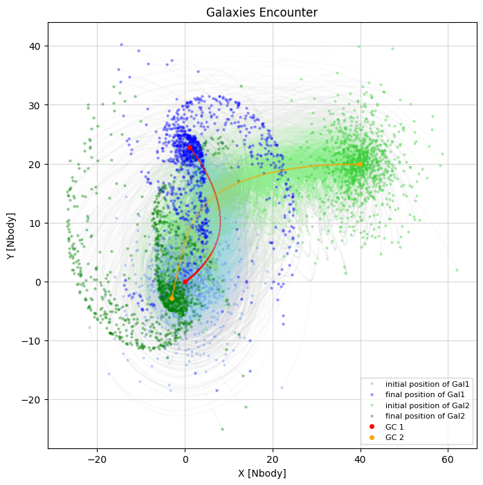
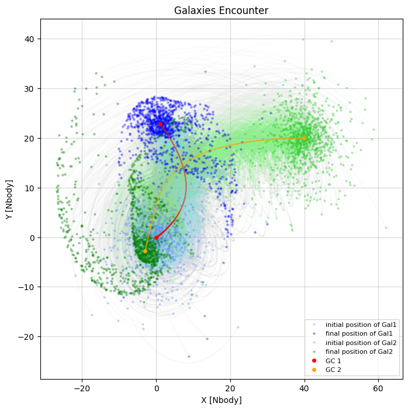
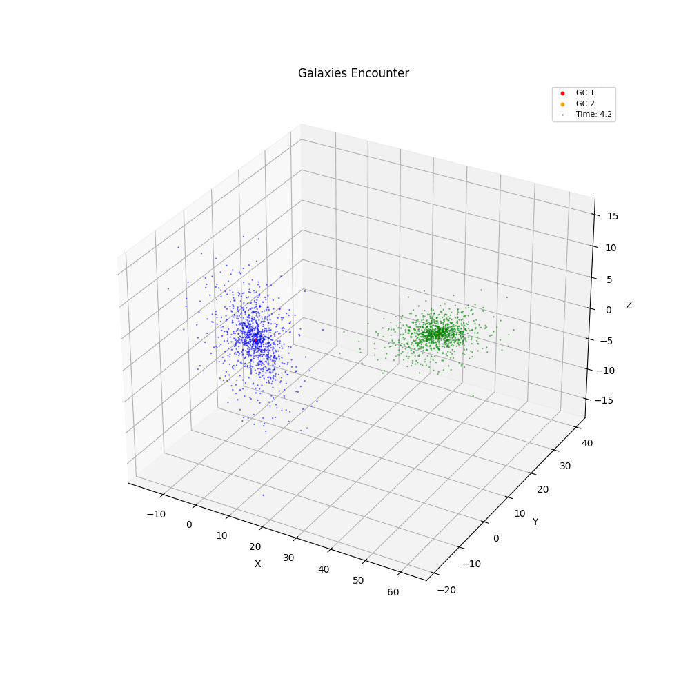

# GAMALOS 🌌
**GAlaxies MAking LOve Simulation**

An N-body simulation of the encounter between two disc galaxies, built on the `Fireworks` Python package from the *Computational Astrophysics* course (2023) by professor Giuliano Iorio.


<!-- Cover image: e.g. the final configuration of an encounter -->

---

## What is this project about?

Each galaxy is modelled in a simplified way:

- **one central particle** that holds the whole mass of the galaxy (Plummer profile);
- **many low-mass tracers** that represent the stellar disc, placed on circular orbits in a thin exponential disc.

By following the tracers we can see how the **shape** and the **kinematics** of the discs change when two galaxies meet, and which structures (e.g. **tidal tails**) are created.

This is a deliberately simple model: gas, star formation, dark matter halos and bulges are not included.


<!-- Initial positions of the two galaxies -->

---

## How it works

| Step | Choice |
|---|---|
| Units | N-body units (G = 1) |
| System type | Collisionless (t_simulation ≪ t_relax, ratio ≈ 0.02) |
| Force computation | `acceleration_pyfalcon` (tree code, Dehnen algorithm) |
| Integrator | Leapfrog |
| Initial conditions | `Generate_Nbody_disc.py` → `Nbody_disc.csv` (exponential disc R_d = 3, Plummer scale a = 5) |
| Particles | 10³ per galaxy (limited by available computing power) |

---

## Content of the analysis

The notebook `gamalos.ipynb` is divided in 7 chapters:

1. **N-body** – theory, units, collisional vs collisionless systems, tree algorithms, the Fireworks package
2. **Project overview** – integration method and initial conditions
3. **Stability of the disc** – an isolated galaxy over one orbital period (rotation curve and surface density)
4. **Encounter 1** – same rotation direction, same plane
5. **Encounter 2** – counter-rotating galaxies, same plane
6. **Encounter 3** – same rotation direction, different disc inclinations
7. **Conclusions**

---

## Main results

**Stability.** An isolated galaxy keeps a stable rotation curve and surface density over one period.



**Same-plane encounter.** The discs lose stability: stars migrate to larger radii, some start to counter-rotate, and two **tidal tails** form.



**Counter-rotating encounter.** Similar results, but the structures are more complex and some stars are captured by the other galaxy.



**Inclined encounter.** Tidal structures form again, and a small vertical velocity appears because the problem becomes 3D.


**Animation**



---

## What we implemented in Fireworks

- `particles`: kinetic and potential energy (loop and vectorised versions)
- `ic`: `ic_random_uniform`
- `dynamics`: `acceleration_direct`, `acceleration_vectorized`, `acceleration_jerk_direct`
- `integrators`: Euler, Leapfrog, Runge-Kutta
- `timesteps`: `adaptive_timestep_r`

---

## Repository structure

```
.
├── assignments/                # assignmets of the Computational Astrophysics course
├── GAMALOS/
│   ├── data/                   # initial conditions (Nbody_disc.csv)
│   ├── images/                 # figures and gifs
│   ├── gamalos.ipynb           # MAIN NOTEBOOK with the full analysis
│   └── generate_nbody_disc.py  # generates the galaxy initial conditions
├── Fireworks/                  # N-body package
├── Docker/
├── logo.png
```

---

## How to run

Use the Dockerfile in the Docker folder to create a Docker image and container.

---

## Possible improvements

- add a random (Gaussian) velocity component to the initial conditions;
- add other components: dark matter halo (NFW), bulge (Hernquist), gas;
- use more particles (needs more computing power).

---

## Authors

Giada Aggio, Marco Boscato, Mattia Merola

## Credits and license

Based on the course repository [`pod_compastro23`](https://gitlab.com/iogiul/pod_compastro23) by Giuliano Iorio.
Released under the **MIT License**, see [`LICENSE`](LICENSE) inside [`Fireworks`] folder.
